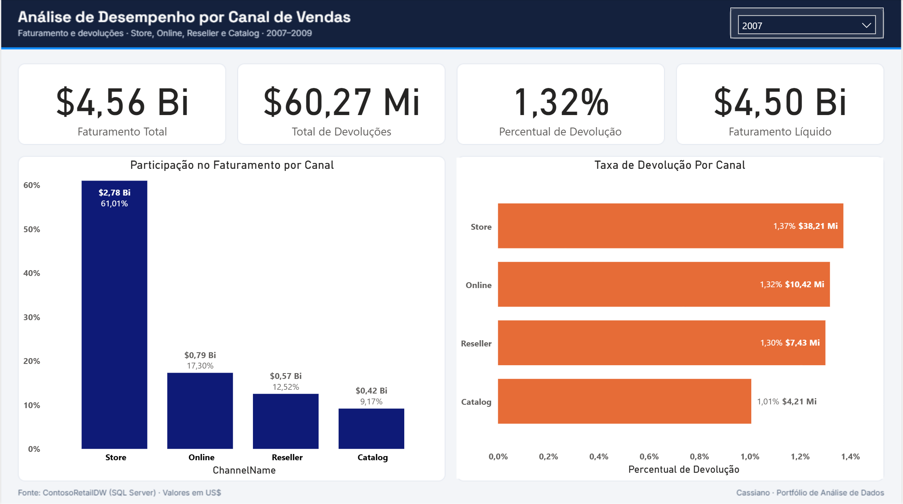

# 📊 Análise de Desempenho por Canal de Vendas

**Pergunta de negócio:** qual canal de vendas mais vende e mais devolve? E as devoluções são um problema específico de algum canal?



## 🔍 Principais conclusões

- **Store domina as vendas:** responde por **~56%** da receita total, mais que o dobro do segundo colocado (Online, ~22%).
- **O ranking de devoluções repete o de vendas:** Store também lidera em valor devolvido, mas isso é efeito do volume, não de um problema do canal.
- **A taxa de devolução é praticamente igual entre os canais:** de 1,10% (Catalog) a 1,30% (Store), uma diferença de apenas 0,2 ponto percentual. Ou seja, **as devoluções não são um problema de um canal específico**. Se houver algo a investigar, provavelmente está em produto ou categoria, não no canal.

| Canal | Vendas | % das vendas | Devoluções | Taxa de devolução |
|---|---:|---:|---:|---:|
| Store | 6.942.853.195,14 | 55,9% | 90.642.941,90 | 1,30% |
| Online | 2.677.599.035,07 | 21,6% | 32.983.261,28 | 1,23% |
| Reseller | 1.715.197.831,44 | 13,8% | 21.306.891,59 | 1,24% |
| Catalog | 1.078.007.547,23 | 8,7% | 11.906.281,08 | 1,10% |
| **Total** | **12.413.657.608,88** | **100%** | **156.839.375,85** | **1,26%** |

## 🗂️ Dados

[ContosoRetailDW](https://www.microsoft.com/en-us/download/details.aspx?id=18279): data warehouse fictício de varejo da Microsoft, em modelo estrela, carregado no SQL Server.

## ⚙️ Como foi feito

1. **SQL** (`/sql`): queries em T-SQL que calculam vendas, devoluções e taxa de devolução por canal.
2. **Power BI** (`/powerbi`): dashboard com [descrever os principais visuais: cartões de KPI, gráfico de vendas por canal, taxa de devolução etc.].

## 🛠️ Tecnologias

SQL Server (T-SQL) · Power BI · DAX

## 📁 Estrutura

```
├── sql/        # Queries de análise
└── powerbi/    # Arquivo .pbix e print do dashboard
```
